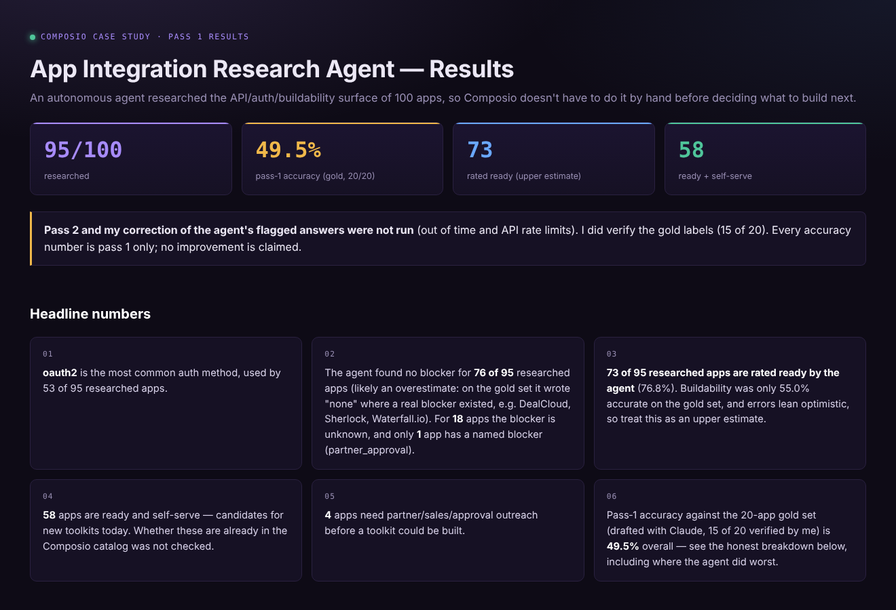
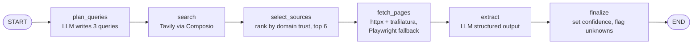

<div align="center">

# App Integration Research Agent

**Researches 100 SaaS apps for integration readiness: auth methods, self-serve vs gated, API type, existing MCP server, whether a toolkit can be built, and the main blocker. Every answer comes with evidence links, and the agent is checked against a 20-app gold set.**

*LangGraph + Composio tools, free-tier LLMs, results on one static page.*

**Live report: https://d3nzl6pdmybljj.cloudfront.net**

<br>


<br>



</div>

<br>

## What it does

This is my take on the Composio case study. For each of 100 apps (10 categories), the agent searches the web, reads the docs, and fills one record:

- **auth methods** (oauth2, api key, bearer token, and so on)
- **access**: self-serve free, trial, paid plan, admin approval, app review, contact sales
- **API type**: REST, GraphQL, gRPC, websocket, SDK only, CLI only
- **existing MCP server**: official, community, or none found
- **buildability** and the **main blocker** for a new toolkit
- **evidence URLs** and a **confidence** level for each field

Then I look for patterns across the 100 apps and check the agent's accuracy against 20 apps with gold labels. All of it is shown on one static page.

## Results (pass 1 only)

**Only pass 1 was run.** The second pass (checks and retries) and my own correction pass were planned but I ran out of time and API quota. Nothing on the page claims an improvement.

- **95 of 100** apps have a record. 5 failed extraction and are shown as "not researched": QuickBooks, Xero, Otter AI, Fathom, Reducto.
- **Accuracy on the 20 gold apps: 49.5%** (53 of 107 field values). This is a strict score; see the scoring rule below.
- **Low confidence is a useful signal.** The agent marked 19 gold-set values as `low` confidence, and 18 of them were wrong.
- **Buildability is optimistic.** 73 of 95 apps are rated "ready", but buildability was only 55% accurate on the gold set and the errors lean optimistic, so treat 73 as an upper estimate.
- **58 apps** are rated ready and self-serve. I did not check whether they are already in the Composio catalog.
- **oauth2** is the most common auth method (53 of 95 apps).

| Field | Accuracy |
|---|---|
| api_type | 65.0% |
| buildability | 55.0% |
| access | 50.0% |
| main_blocker | 50.0% |
| auth_methods | 35.0% |
| existing_mcp | 28.6% |

| Model | Accuracy | Notes |
|---|---|---|
| gemini-3.5-flash-lite | 59.2% | Used for 48 apps until the free daily quota ran out |
| openai/gpt-oss-120b (Groq) | 55.3% | Used next |
| qwen/qwen3.8-27b (Groq) | 15.0% | Last fallback, marked "lower reliability" on the page |

**Scoring rule.** A value counts as correct when it equals gold, including when both are `unknown`. `auth_methods` and `api_type` are exact set matches, so one extra item counts as a miss. With a looser rule (all gold values present) the scores are 70% for auth and 90% for api type. `api_breadth` is not scored, and `existing_mcp` is scored only on gold rows I verified.

## How it works



1. The LLM writes 3 search queries for the app.
2. Search runs through Composio (Tavily), 1 credit per query.
3. Sources are ranked by domain trust and the top 6 are kept.
4. Pages are fetched with `httpx` and `trafilatura`, with a Playwright fallback for pages that need JavaScript.
5. The LLM fills a structured `AppRecord`. Fields it cannot support are set to `unknown`.
6. A final step sets confidence and flags the unknowns.

This is the graph that ran. The verify and retry loop (checks against the evidence, a second search for failed fields) is in the design but was **not run**.

## Gold labels

- The 20 gold labels were **drafted with Claude** from official docs, without looking at the agent's output.
- **I verified 15 of 20** against the sources myself. Verified by me: HubSpot, Twenty, DealCloud, Zendesk, Slack, WhatsApp Business, Google Ads, Shopify, Amazon Selling Partner, fanbasis, DataForSEO, Sherlock, Waterfall.io, GitHub, Notion. Not verified by me line by line: Stripe, iPayX, PitchBook, NotebookLM, Mermaid CLI..
- I found one wrong label: **fanbasis**. Its real docs are on `commasdocs.com`, a different domain from the product site, and I corrected it. The agent's search missed that domain too.

## What went wrong and what I did

- Gemini's free daily quota ran out partway through, and it was shared with another project of mine. I switched to Groq (`gpt-oss-120b`), and then to `qwen3.8-27b` when that hit its own daily limit. The qwen records are the weakest.
- Two runs wrote to the same output at once. I fixed it with a lock file and atomic writes.
- I found the 5 failed apps by reading the run logs. They are listed as "not researched" and not guessed.
- I decided to skip pass 2 and the correction pass rather than report numbers I could not back up.

## Limitations

- Pass 1 accuracy is 49.5%, which is well short of production quality.
- 49 of 95 researched apps have at least one `unknown` or low-confidence field.
- The qwen model's records are much less reliable. This comes from switching providers under free-tier limits, not from the agent design.
- Exact-set scoring is harsh on list fields.
- The gold set has only 20 apps, and 5 of the labels are not verified by me line by line.
- The "ready" and "blocker" fields are optimistic. The agent often wrote `none` where gold had a real blocker.
- The Composio catalog cross-check was not run.

## Next steps

- Re-run the apps that qwen processed and the 5 failed ones on `gpt-oss-120b` after the quota resets.
- Build pass 2: check that each quote appears in the page, that links are alive, and that fields agree with each other; add the Composio catalog check.
- Review the low-confidence fields by hand and re-score.

## Tech stack

| Part | Choice |
|---|---|
| Agent | LangGraph, Python (uv project) |
| Tools | Composio SDK (Tavily search), httpx, trafilatura, Playwright |
| LLMs | Gemini `gemini-3.5-flash-lite`, fallback Groq `openai/gpt-oss-120b`, then `qwen/qwen3.8-27b` |
| Report | One static HTML page, generated from the results |
| Hosting | S3 (private) + CloudFront with Origin Access Control, `ap-south-1` |

## Project structure

```
.
├── src/research_agent/
│   ├── graph.py          # LangGraph pipeline
│   ├── llm.py            # Gemini and Groq calls, retry and fallback
│   ├── tools.py          # Search and page fetching
│   ├── prompts.py        # Prompts
│   ├── schema.py         # AppRecord fields
│   ├── config.py         # Settings from environment variables
│   ├── budget.py         # Usage limits
│   ├── retry.py          # Retry helper
│   ├── run.py            # Runs all apps (resumable)
│   ├── evaluate.py       # Scores results against the gold labels
│   └── analyze.py        # Finds patterns across the apps
├── data/
│   ├── apps.csv          # The 100 apps
│   └── gold/gold_labels.csv
├── output/               # pass1.json, failures, eval and pattern results
├── site/
│   ├── build.py          # Builds the page
│   └── dist/             # index.html, results.csv, results.json, metrics.json, llms.txt
├── main.py
├── pyproject.toml
├── uv.lock
└── .env.example
```

## Run it yourself

**Prerequisites:** Python, [uv](https://docs.astral.sh/uv/), and API keys for Composio, Gemini and Groq. Copy `.env.example` to `.env` and fill in the values.

```bash
uv sync

# Research all 100 apps (resumable: skips apps already in output/pass1.json)
uv run research --all

# Score against the gold labels
uv run python -m research_agent.evaluate

# Find patterns and rebuild the page
uv run python -m research_agent.analyze && uv run python site/build.py
```

The page is written to `site/dist/`. To publish it to S3 and CloudFront:

```bash
aws s3 sync site/dist/ s3://<your-bucket>/ --delete
aws cloudfront create-invalidation --distribution-id <your-distribution-id> --paths "/*"
```

The live page was restyled by hand after `build.py` made it, so running `build.py` gives the same content with a plainer look.

## Downloads

The same data as the page: [results.json](site/dist/results.json) · [results.csv](site/dist/results.csv) · [metrics.json](site/dist/metrics.json) · [llms.txt](site/dist/llms.txt)

## How this was built

I built this with Claude Code and Claude: the gold labels were drafted with Claude, and Claude Code wrote much of the code and the page under my direction. The decisions on scope, the model switches, the gold-label checks, and what the page claims are mine.

## Author

Built by [Sarang](https://github.com/sarangKP).
