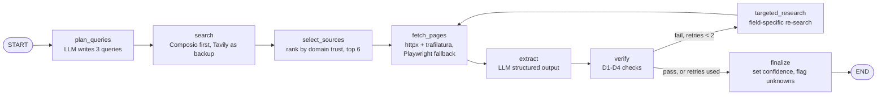

<div align="center">

# App Integration Research Agent

**Researches 100 SaaS apps for integration readiness: auth methods, self-serve vs gated, API type, existing MCP server, whether a toolkit can be built, and the main blocker. Every answer comes with evidence links, and the agent is checked against a 20-app gold set.**

*LangGraph + Composio tools, free-tier LLMs, results on one static page.*

**Live report: https://d3nzl6pdmybljj.cloudfront.net**

<br>


<br>


</div>

<br>

## What it does

This is my take on the Composio case study. For each of 100 apps (10 categories), the agent searches the web, reads the docs, and fills one record:

- **auth methods** (oauth2, api key, bearer token, and so on)
- **access**: self-serve free, trial, paid plan, admin approval, app review, contact sales
- **API type**: REST, GraphQL, gRPC, websocket, SDK only, CLI only
- **existing MCP server**: official, community, or none found
- **buildability** and the **main blocker** for a new toolkit
- **evidence URLs** and a **confidence** level for each field

The results are then analysed for patterns across the 100 apps, and the agent's accuracy is checked against 20 apps with gold labels. All of it is shown on one static page.

## Results

### Pass 1 (100 apps)

In the original submission, the second pass (checks and retries) and the correction pass were not run, because time and API quota ran out.

- **95 of 100** apps have a record. 5 failed extraction and are shown as "not researched": QuickBooks, Xero, Otter AI, Fathom, Reducto.
- **Accuracy on the 20 gold apps: 49.5%** (53 of 107 field values). This is a strict score; see the scoring rule below.
- **Low confidence is a useful signal.** 19 gold-set values were marked `low` confidence, and 18 of them were wrong.
- **Buildability is optimistic.** 73 of 95 apps are rated "ready", but buildability was only 55% accurate on the gold set and the errors lean optimistic, so 73 is an upper estimate.
- **58 apps** are rated ready and self-serve. Checked against Composio's public toolkit list (see "Composio catalog check" below): 49 already have a toolkit, 1 (Netlify) has an MCP-only toolkit, and 8 do not.
- **oauth2** is the most common auth method (53 of 95 apps).

| Field | Accuracy |
|---|---|
| api_type | 65.0% |
| buildability | 55.0% |
| access | 50.0% |
| main_blocker | 50.0% |
| auth_methods | 35.0% |
| existing_mcp_status | 28.6% |

| Model | Accuracy | Notes |
|---|---|---|
| gemini-3.5-flash-lite | 59.2% | Used for 48 apps until the free daily quota ran out |
| openai/gpt-oss-120b (Groq) | 55.3% | Used next |
| qwen/qwen3.8-27b (Groq) | 15.0% | Last fallback, marked "lower reliability" on the page |

**Scoring rule.** A value counts as correct when it equals gold, including when both are `unknown`. `auth_methods` and `api_type` are exact set matches, so one extra item counts as a miss. With a looser rule (all gold values present) the scores are 70% for auth and 90% for api type. `api_breadth` is not scored, and `existing_mcp_status` is scored only on gold rows I verified.

### Pass 2 (50 of 100 apps)

Pass 2 ran the verify/retry loop on **50 apps only**: the 20 gold apps, the 5 that failed in pass 1 (QuickBooks, Xero, Otter AI, Fathom, Reducto), and the 25 with the most D1/D2/D4 check failures in pass 1. It used Gemini (`gemini-3.5-flash-lite`) only, with no fallback model. **The other 50 apps were not re-run and still show their pass 1 results.**

**On the 20 gold apps, overall accuracy did not change: pass 1 53/107 (49.5%) → pass 2 53/107 (49.5%).**

| Field | pass 1 | pass 2 |
|---|---|---|
| auth_methods | 7/20 | 5/20 |
| api_type | 13/20 | 12/20 |
| access | 10/20 | 10/20 |
| buildability | 11/20 | 13/20 |
| main_blocker | 10/20 | 10/20 |
| existing_mcp_status | 2/7 | 3/7 |

On the 9 gold apps whose pass 1 record also came from Gemini, accuracy went from 29/49 to 31/49 — 2 more correct answers, too few to call an improvement.

**8 regressions, not hidden:**

- `DealCloud` / `api_type`, `Zendesk` / `api_type`, `Sherlock` / `api_type`, `WhatsApp Business` / `auth_methods`, `PitchBook` / `auth_methods` — in all five, pass 2 added an extra value to a list field; the exact-set scoring rule marks the whole field wrong even though the original correct value is still there; the extra values were not checked one by one.
- `fanbasis` / `auth_methods` and `fanbasis` / `access` — correct in pass 1, `unknown` in pass 2. A real loss, not a scoring artifact: fanbasis's real docs are on `commasdocs.com`, a different domain from its product site, and pass 2's search missed that domain again, the same way pass 1's did.
- `Waterfall.io` / `access` — `unknown` in pass 1, a specific (wrong, per gold) guess in pass 2.

**Verification audit (the D1-D4 checks `verify` enforces), pass 1 vs pass 2, same 50 apps:**

| Check | pass 1 (45 apps) | pass 2 (50 apps) |
|---|---|---|
| D1 (quote on page) | 29 apps failing | 2 apps failing |
| D2 (trusted source) | 13 apps failing | 0 apps failing |
| D3 (fetched 200) | 1 app failing | 0 apps failing |
| D4 (fields agree) | 8 apps failing | 14 apps failing (worse) |

Pass 1 only has 45 of the 50 apps here, not 50, because the other 5 failed outright and have no pass 1 record. D1-D3 improved sharply, which is what the retry loop is for. **D4 got worse**: D4 checks three rules, not only MCP URLs - access/buildability, api_type/main_blocker, and existing_mcp_status/existing_mcp_url. On the 45 apps present in both passes, pass 1 had 21 apps with `existing_mcp_status` official/community (7 of those missing a URL); pass 2 had 20 (11 missing a URL) - accounting for the shared-45-app rise (8 → 11 failing). The rest of the jump to 14 comes from 3 of the 5 apps pass 1 never researched at all (Xero, Fathom, Reducto), which pass 2 also flagged as official/community with no URL. So the URL counts explain the whole rise within the shared 45 apps, but only part of the 8-to-14 figure in the table above, which compares different app counts. Pass 2 is not claiming official/community more often overall; it is more likely to leave the URL missing when it does make that claim. The cause was not measured. This audit shows pass 2's evidence is better grounded against these specific checks - it is not a measure of whether the final answers are more accurate; the gold comparison above is.

**Human review of 8 apps**

I checked 13 fields on 8 apps against vendor pages and search results: HubSpot, Close, Copper, GitHub, Notion, Jira, Linear and Clay. The agent had flagged 7 of the 8 (HubSpot and Close existing_mcp; unknown existing_mcp for GitHub, Notion, Jira, Linear, Clay). Copper was not flagged.

- Wrong or missed (6): Copper existing_mcp "none" (an official server is announced but not public yet, and third-party servers exist); existing_mcp "unknown" for GitHub, Notion, Jira, Linear and Clay, where an official server exists for each.
- Unproven or weak (3): Close access "paid_plan_required" (the pricing page shows a free trial that seems to include API access; one FAQ answer was not fully read); Close "bearer_token" (the API key page says HTTP Basic; the OAuth page was not opened); HubSpot's single "public beta" quote used for 3 fields (an old changelog post).
- Held up (4): HubSpot official MCP, Close official MCP, Copper auth methods, HubSpot bearer_token (a Bearer header, but not a separate method).

For the five "unknown" apps I looked at Google results, not the vendors' own pages, so server URLs are not confirmed. URLs for HubSpot and Close were not found on the pages I opened. These apps were picked because they were flagged or looked doubtful, so the counts are not an error rate for all 50 apps. The data files were not changed. Notes are in data/human_review_notes.md.

**Confidence calibration on the gold fields:**

| Confidence | pass 1 | pass 2 |
|---|---|---|
| high | n/a (pass 1 has no `high` tier) | 29/52 (55.8%) |
| medium | 52/88 (59.1%) | 21/44 (47.7%) |
| low | 1/19 (5.3%) | 3/11 (27.3%) |

`high` is not reliably better than `medium` yet - in this sample it scored lower.

**29 of the 50 pass 2 apps have at least one field flagged for human review.**

**Gemini 429s happened 12 times in total across the pass 2 runs.** Every one was retried and absorbed by Google's own client library before it ever reached this project's code. This project's own wait-60s-and-stop logic for 429s was not exercised in these runs.

## Composio catalog check

After pass 1, all 100 apps were checked against Composio's public toolkit list (https://docs.composio.dev/toolkits, 1,841 toolkits) on 23 Nov 2026. This was done with Claude in Chrome, not by the agent. Each app was matched by name, and short names that could be a different product were checked by reading the toolkit description (Close, Front, Plain, Copper, Clay, Grain, Consensus, Ramp).

| | Apps |
|---|---|
| Has a toolkit in the catalog | 76 |
| Only an MCP-server toolkit (Pylon, Netlify, Otter AI, Devin) | 4 |
| Not found | 20 |

Of the 58 apps rated ready and self-serve:

- **49** already have a toolkit.
- **1** (Netlify) has an MCP-only toolkit.
- **8** are not in the catalog: DealCloud, LiveAgent, systeme.io, WooCommerce, Salesforce Commerce Cloud, fanbasis, SE Ranking, Sherlock.

These 8 are leads, not answers. Three of them are gold apps. **fanbasis** matched gold (self-serve, ready, no blocker), so it is a real lead. **DealCloud** and **Sherlock** were wrong on the gold set (admin approval, and CLI-only), so they are not. The other 5 were not checked.

Of the 5 apps that were not researched, QuickBooks, Xero and Fathom are in the catalog, Otter AI has an MCP-only toolkit, and Reducto is not found.

Limits: a name match shows that a toolkit exists, not how many tools it has or whether the auth is complete. A few matches are looser than exact: GoHighLevel is listed as HighLevel, Zoho CRM sits under the general Zoho toolkit, and NotebookLM is the Enterprise toolkit. Amazon Selling Partner is not matched, because the `amazon` toolkit is a different one. Per-app results are in [`data/composio_catalog_check.json`](data/composio_catalog_check.json), and `results.json` and `results.csv` have new `composio_catalog` and `composio_toolkit` columns.

## How it works



1. The LLM writes 3 search queries for the app.
2. Search goes through Composio first, and falls back to the Tavily API directly if that fails.
3. Sources are ranked by domain trust, and the top 6 are kept.
4. Pages are fetched with `httpx` and `trafilatura`, with a Playwright fallback for pages that need JavaScript.
5. The LLM fills a structured `AppRecord`. Fields it cannot support are set to `unknown`.
6. `verify` runs four checks (below). If any field fails and the app has not been retried twice, a second, field-specific search and fetch runs before `verify` again. On a retry, fields that passed keep their old value and evidence. Only the failed fields are replaced.
7. When a field passes, or the retries are used up, `finalize` sets the confidence and flags the unknowns. Fields still failing after 2 retries are flagged for human review.

The four checks in `verify`:

- **D1 (quote on page):** the evidence quote must appear in the text of the page fetched for it.
- **D2 (trusted source, depends on field):** the evidence URL's host must be trusted for that field. For most fields that means the app's own domain. For the two MCP fields, GitHub, npm and known MCP registries are also allowed.
- **D3 (fetched 200):** the evidence URL must have been fetched successfully, status 200.
- **D4 (fields agree):** some field pairs must make sense together. For example, if `access` is `no_public_api`, `buildability` must be `blocked`.

## Gold labels

- The 20 gold labels were **drafted with Claude** from official docs, without looking at the agent's output.
- **I verified 15 of 20** against the sources myself. Verified by me: HubSpot, Twenty, DealCloud, Zendesk, Slack, WhatsApp Business, Google Ads, Shopify, Amazon Selling Partner, fanbasis, DataForSEO, Sherlock, Waterfall.io, GitHub, Notion. Not verified by me line by line: Stripe, iPayX, PitchBook, NotebookLM, Mermaid CLI.
- I found one wrong label: **fanbasis**. Its real docs are on `commasdocs.com`, a different domain from the product site, and I corrected it. The agent's search missed that domain too.

## What went wrong and what was done

- Gemini's free daily quota ran out partway through, and it was shared with another project of mine. The run switched to Groq (`gpt-oss-120b`), and then to `qwen3.8-27b` when that hit its own daily limit. The qwen records are the weakest.
- Two runs wrote to the same output at once. A lock file and atomic writes fixed this.
- The 5 failed apps were found by reading the run logs. They are listed as "not researched" and not guessed.
- Pass 2 and the correction pass were skipped in the first submission, rather than report numbers that could not be backed up. Pass 2 was added and run afterwards, on 50 of the 100 apps; results are in "Results" above and the run mechanics are in "Running pass 2".

## Limitations

- Pass 1 accuracy is 49.5%, which is well short of production quality.
- 49 of 95 researched apps have at least one `unknown` or low-confidence field.
- The qwen model's records are much less reliable. This comes from switching providers under free-tier limits, not from the agent design.
- Exact-set scoring is harsh on list fields.
- The gold set has only 20 apps, and 5 of the labels are not verified by me line by line.
- The "ready" and "blocker" fields are optimistic. The agent often wrote `none` where gold had a real blocker.
- The agent's own catalog check never ran. The catalog check above was done separately, by name, so it shows that a toolkit exists, not how complete it is.
- D1 only checks that the evidence quote exists on the page it cites - it does not check that the quote actually supports the field's value. A real quote next to a wrong conclusion still passes.
- List fields can pick up extra values. Exact-set scoring marks the whole field as a miss. The extra values were not checked one by one, so some may be wrong.
- An `unknown` `api_breadth` or `unknown` `existing_mcp_status` can never trigger a retry under the current checks, by construction, not bad luck. Of the fields left `unknown` after pass 2, 31 were never retried for this reason.
- The gold set is small: 20 apps total, and only 7 of them have a verified `existing_mcp_status` label, so the existing_mcp_status numbers above are on a thin sample.
- No flag does not mean correct: Copper's existing_mcp was `none` with no evidence and no flag, and it was wrong. All 5 `unknown` MCP values checked by hand were findable.

## Next steps

**Planned, not done yet:**

- Let unknown `api_breadth` and `existing_mcp_status` fields trigger a retry.
- Check that each value in a list field has its own supporting quote.
- Look for docs on a different domain than the product site (the fanbasis case).
- Review the rest of the 29 flagged apps and the low-confidence fields, and re-score.
- Run pass 2 on the other 50 apps when quota allows.

## Tech stack

| Part | Choice |
|---|---|
| Agent | LangGraph, Python (uv project) |
| Tools | Composio SDK (Tavily search), httpx, trafilatura, Playwright |
| LLMs | Gemini `gemini-3.5-flash-lite`, fallback Groq `openai/gpt-oss-120b`, then `qwen/qwen3.8-27b` |
| Report | One static HTML page, generated from the results |
| Hosting | S3 (private) + CloudFront with Origin Access Control, `ap-south-1` |

## Project structure

```
.
├── src/research_agent/
│   ├── graph.py          # LangGraph pipeline
│   ├── llm.py            # Gemini and Groq calls, retry and fallback
│   ├── tools.py          # Search and page fetching
│   ├── prompts.py        # Prompts
│   ├── schema.py         # AppRecord fields
│   ├── config.py         # Settings from environment variables
│   ├── budget.py         # Usage limits
│   ├── retry.py          # Retry helper
│   ├── run.py            # Runs all apps (resumable)
│   ├── evaluate.py       # Scores results against the gold labels
│   └── analyze.py        # Finds patterns across the apps
├── data/
│   ├── apps.csv          # The 100 apps
│   ├── composio_catalog_check.json  # Which apps have a Composio toolkit
│   └── gold/gold_labels.csv
├── output/               # pass1.json, failures, eval and pattern results
├── site/
│   ├── build.py          # Builds the page
│   ├── templates/index.html.j2
│   └── dist/             # index.html, results.csv, results.json, metrics.json, llms.txt
├── pyproject.toml
├── uv.lock
└── .env.example
```

## Run it yourself

**Prerequisites:** Python 3.13+, [uv](https://docs.astral.sh/uv/), and these keys in `.env` (copy from `.env.example`):

- `COMPOSIO_API_KEY` and `TAVILY_API_KEY`: search calls Composio first, and falls back to the Tavily API directly with `TAVILY_API_KEY` if that fails.
- An LLM key for the pass being run: `GOOGLE_API_KEY` for Gemini (pass 2), `GROQ_API_KEY` for Groq (pass 1).

```bash
uv sync

# Research all 100 apps (resumable: skips apps already in output/pass1.json)
uv run research --all

# Score against the gold labels
uv run python -m research_agent.evaluate

# Find patterns and rebuild the page
uv run python -m research_agent.analyze && uv run python site/build.py
```

The page is written to `site/dist/`. To publish it to S3 and CloudFront:

```bash
aws s3 sync site/dist/ s3://<your-bucket>/ --delete
aws cloudfront create-invalidation --distribution-id <your-distribution-id> --paths "/*"
```

The live page was restyled by hand after `build.py` made it, so running `build.py` gives the same content with a plainer look.

## Running pass 2

Pass 2 runs the full graph above, including the verify and retry loop, using Gemini (`gemini-3.5-flash-lite`) instead of Groq, with no fallback model. It runs on 50 apps: the 20 gold apps, the 5 that failed pass 1 outright, and the 25 with the most check failures in pass 1 (`scripts/pick_pass2_apps.py`, output in `data/pass2_apps.json`). The other 50 apps keep their pass 1 results.

Gemini's free tier is tight: **15 requests/minute, 250K tokens/minute, 500 requests/day.** The runner stays under these limits (13 requests/minute, 220K tokens/minute) and is designed to stop on a 429 instead of switching models (not exercised in the pass 2 runs, because Google's client retried every 429 itself), since Gemini has no fallback here.

```bash
# Trial on a few apps first
LLM_PROVIDER=gemini uv run research \
  --apps-file data/pass2_apps.json \
  --only "HubSpot,Close,Copper" \
  --output-prefix pass2

# Then in batches: already-completed apps are skipped automatically
LLM_PROVIDER=gemini uv run research \
  --apps-file data/pass2_apps.json \
  --limit 13 \
  --output-prefix pass2
```

`--output-prefix pass2` keeps this fully separate from pass 1. It reads and writes only `output/pass2.json` and `output/pass2_failures.json`, and never opens `output/pass1.json`.

## Downloads

The same data as the page: [results.json](site/dist/results.json) · [results.csv](site/dist/results.csv) · [metrics.json](site/dist/metrics.json) · [llms.txt](site/dist/llms.txt)

## Author

Built by [Sarang](https://github.com/sarangKP).